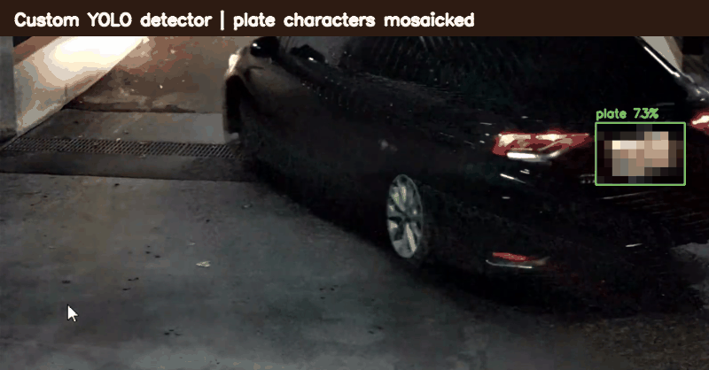

# Taiwan License Plate Recognition

A computer-vision pipeline that detects Taiwanese license plates with a custom
YOLO model and recognizes plate text with InternVL3. It supports video files,
webcams, and RTSP streams, with optional annotated video output.

## Demo



This clip was generated with the project's model and original test footage
owned by the author. The detector output is real. Plate characters, recorder
timestamps, and the recorder sidebar were removed from the published preview
for privacy.

## Highlights

- Custom YOLO license-plate detection
- Taiwanese plate-text recognition with InternVL3
- Automatic CUDA acceleration with a CPU fallback
- Configurable confidence, frame stride, source, and output path
- Lightweight detection-only mode for faster testing
- Raw videos, datasets, OCR caches, and model weights excluded from Git

## Pipeline

```text
Video / webcam / RTSP stream
          |
          v
  YOLO plate detector
          |
          v
    Crop each plate
          |
          v
 InternVL3 text recognition
          |
          v
Annotated preview or MP4 output
```

## Project structure

```text
.
|-- main.py             # Detection and plate-text recognition
|-- detect.py           # Faster YOLO-only detection baseline
|-- assets/
|   `-- detection-demo.gif
|-- models/
|   `-- README.md       # Local model setup
|-- tests/
|   `-- test_pipeline.py
|-- requirements.txt
`-- .gitignore
```

## Setup

1. Create and activate a Python virtual environment.
2. Install the dependencies:

   ```bash
   pip install -r requirements.txt
   ```

3. Follow [`models/README.md`](models/README.md) to place the custom detector at
   `models/license_plate_yolo.pt`.

The OCR model downloads from Hugging Face on the first recognition run and
requires several gigabytes of memory. A CUDA-capable GPU is recommended.

## Usage

Run detection and recognition on a video:

```bash
python main.py --source sample.mp4
```

Use a webcam:

```bash
python main.py --source 0
```

Save annotated output and reduce OCR workload by processing every fifth frame:

```bash
python main.py --source sample.mp4 --frame-stride 5 --output outputs/result.mp4
```

Run only the lightweight YOLO detector:

```bash
python detect.py --source sample.mp4
```

Press `Q` or `Esc` to stop a preview.

## Tests

The test suite checks command-line parsing, input-source handling, output-writer
configuration, OCR response handling, and early validation failures without
downloading model weights:

```bash
python -m unittest discover -s tests -v
```

## Privacy and responsible use

License plates can identify or track real people. Use this project only on
footage you are authorized to process. Do not publish readable plate numbers,
location information, or private camera metadata.

The repository excludes raw footage, full datasets, model weights, and
downloaded OCR files. The included demo is cropped and mosaicked for privacy.

## Built with

Python · YOLO · OpenCV · PyTorch · Transformers · InternVL3

